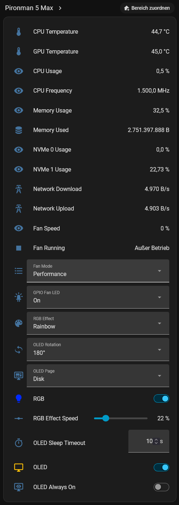

# Pironman 5 Family — Home Assistant Integration

**Monitor and control compatible SunFounder Pironman 5 family hardware directly from Home Assistant.**

A fully local custom integration for **Home Assistant Container**, Home Assistant OS and other supported Home Assistant installations. Works with the Pironman software's local REST API, including setups where Home Assistant runs on a different machine.

[](https://github.com/ChristophKomenda/pironman5-homeassistant-container/releases/latest)
[](https://github.com/ChristophKomenda/pironman5-homeassistant-container/actions/workflows/validate.yml)
[](LICENSE)
[](https://github.com/hacs/default/pull/12242)

**Local REST API · No MQTT · No cloud dependency · Configurable polling · Native Home Assistant entities**

[Install](#installation) · [Features](#features) · [Configure](#configuration) · [Troubleshooting](#troubleshooting) · [Community](#community--support)

> [!IMPORTANT]
> **Official HACS default repository integration.** Pironman 5 was reviewed and accepted via [hacs/default#12242](https://github.com/hacs/default/pull/12242). Find **Pironman 5** directly in HACS; no custom repository URL is needed.


## Integration Preview

<p align="left">
  
</p>

<p align="left">
  <em>Monitor your Raspberry Pi and manage Pironman hardware directly from Home Assistant.</em>
</p>

## At a glance

| | |
|---|---|
| **Hardware** | Pironman 5 family (see verification matrix below) |
| **Home Assistant** | 2024.1.0 or newer |
| **Connection** | Local Pironman REST API, default TCP port `34001` |
| **Installation** | HACS (recommended) or manual |
| **Deployment** | Same Raspberry Pi or a separate LAN host |
| **Latest published release** | `1.2.0` |

The Pironman software must be installed and its REST API running. This integration does **not** replace the upstream Pironman software. Feature and sensor availability depend on your model and API version.

## Hardware compatibility and testing

The integration includes **automatic model detection**, a **manual model override**, and **capability-aware entity setup** for the Pironman 5 family. The integration reads the model ID and supported peripherals from the local SunFounder REST API when available. If the API does not provide a peripheral list, it retains the previous entity setup behavior for backward compatibility.

| Hardware | Integration status | Hardware verification |
|---|---|---|
| SunFounder Pironman 5 Max | Implemented | **Maintainer-tested** with Home Assistant Container 2026.10.1 and Pironman API 1.3.20 |
| SunFounder Pironman 5 | Model detection and capability handling implemented | Not verified on this hardware |
| SunFounder Pironman 5 Mini | Model detection and capability handling implemented | Not verified on this hardware |
| SunFounder Pironman 5 Pro Max | Model detection and capability handling implemented | Not verified on this hardware |

**Important:** Implemented model recognition does **not** establish full compatibility. The Mini and Pro Max may expose different API endpoints and hardware controls. Real-device testing is still required before claiming verified support.

For a model-by-model matrix, reproducible test checklist, and instructions for submitting hardware results, see [Hardware compatibility and testing](docs/hardware-testing.md).

## Why use it?

- **Local by design:** No external account, cloud service, or MQTT broker.
- **Official HACS distribution:** Discover, install, and update from HACS.
- **Container-friendly:** Supports Home Assistant Container, including remote Raspberry Pi deployments.
- **Monitoring:** CPU, GPU, memory, NVMe storage, network traffic, and cooling.
- **Control:** Fan profiles, RGB lighting, and OLED display settings.
- **Flexible:** Configure API host, port, and polling interval without reinstalling.

## Features

### System monitoring

| Category | Available measurements |
|---|---|
| CPU | Temperature, usage, frequency |
| GPU | Temperature |
| Memory | Usage percentage and used memory |
| Storage | NVMe 0 and NVMe 1 usage |
| Network | Download and upload speed |
| Cooling | Fan speed and running status |

Sensor availability depends on the hardware and data provided by the installed Pironman software.

#### Dual NVMe monitoring

| Drive | Expected device path |
|---|---|
| NVMe 0 | `/dev/nvme0n1` |
| NVMe 1 | `/dev/nvme1n1` |

The original NVMe sensor retains its existing unique ID for compatibility. Device paths are currently fixed; automatic drive discovery is a possible future improvement.

### Fan control

Available fan profiles: **Always On**, **Performance**, **Cool**, **Balanced**, and **Quiet**.

GPIO fan LED modes: **On**, **Off**, and **Follow**. Changes are sent to the local Pironman API.

### RGB lighting

Control RGB power, brightness, color, lighting effect, and effect speed using native Home Assistant entities.

| Effect | Behavior |
|---|---|
| Solid | Static color |
| Breathing | Pulsing brightness |
| Flow / Flow Reverse | Moving light animation |
| Rainbow / Rainbow Reverse | Rainbow animation |
| Hue Cycle | Continuous color cycling |

Select effects from the RGB light entity or dedicated effect selector. Use the light in Home Assistant dashboards, scenes, and automations.

### OLED display

Manage OLED power, **Always On**, sleep timeout, rotation, and primary display page.

Available pages: **Mix**, **Performance**, **IPs**, and **Disk** (depending on upstream API and hardware).

#### OLED Always On

| State | Behavior |
|---|---|
| On | Set `oled_sleep_timeout` to `0` |
| Off | Restore the previously observed positive timeout |

To use it, open **Settings → Devices & Services → Pironman 5**, select your device, and toggle **OLED Always On**.

> [!NOTE]
> The main OLED enable switch must be on. The prior timeout is remembered only for the current Home Assistant session. After a restart, the fallback timeout is **10 seconds** if the previous value is unavailable. Continuous OLED operation may increase display wear or burn-in risk.

#### OLED sleep timeout

`0` disables automatic sleep; `1–3600` seconds sets the timeout. The Always On switch is a convenient alternative to setting the value manually.

## Installation

### Option A — HACS (recommended)

1. Open **HACS** in Home Assistant.
2. Search for **Pironman 5**.
3. Open the integration and select **Download**.
4. Follow the installation prompts.
5. Restart Home Assistant when prompted.
6. Continue with [Configuration](#configuration).

**Previously added this as a custom HACS repository?** Avoid duplicate installations; review your existing HACS repository settings before changing anything.

### Option B — Manual installation

1. Download the [latest release](https://github.com/ChristophKomenda/pironman5-homeassistant-container/releases/latest).
2. Copy the `custom_components/pironman5` folder into your Home Assistant configuration directory.
3. Restart Home Assistant.

Expected structure:

```text
config/
└── custom_components/
    └── pironman5/
        ├── __init__.py
        ├── config_flow.py
        ├── coordinator.py
        ├── manifest.json
        ├── strings.json
        ├── translations/
        │   ├── en.json
        │   └── de.json
        └── ...
```

For Home Assistant Container, the configuration directory is usually mounted as `/config` inside the container.

## Configuration

### First-time setup

1. Open **Settings → Devices & Services → Add Integration**.
2. Search for **Pironman 5**.
3. Enter the hostname or IP address of the Raspberry Pi running Pironman.
4. Enter the API port (normally `34001`).
5. Complete setup and check the created entities.

### Automatic model detection and manual override

The integration attempts to identify the Pironman model using the SunFounder API's `/get-device-info` response. Supported model selections are **Automatic**, **Pironman 5**, **Pironman 5 Mini**, **Pironman 5 Max**, and **Pironman 5 Pro Max**. When automatic detection cannot determine the model, select it manually in the integration options.

The integration also reads the API's `peripherals` list, when provided, to avoid creating controls for hardware that the connected device does not report (for example, OLED controls on a device without OLED). On older API versions without this list, the integration preserves its legacy behavior; some unsupported controls may still be shown.

**Note:** A manual model override changes the model label/selection; it does not emulate missing hardware or force unsupported peripherals to appear. Available entities depend on the actual API capabilities. Existing entity unique IDs remain unchanged.

### Change connection settings

Navigate to **Settings → Devices & Services → Pironman 5 → Configure**.

| Setting | Description |
|---|---|
| Host / IP | Address of the Raspberry Pi running the API |
| API port | Default `34001` |
| Polling interval | Configurable from `5` to `60` seconds |
| Model | Automatic (recommended) or manual Pironman 5 family selection |

Configuration changes trigger an integration reload. A **10-second** polling interval is a reasonable starting point. Shorter intervals increase API requests; longer intervals reduce polling traffic.

## Supported deployment scenarios

### Home Assistant and Pironman on the same Raspberry Pi

Both can run on the same host. In Docker, `127.0.0.1` may refer to the container rather than the Raspberry Pi host. Use a host address reachable **from inside the Home Assistant container**; the Raspberry Pi's LAN IP is often easiest.

### Home Assistant on a separate host

```text
Raspberry Pi 5 with Pironman 5 / 5 Max
└── Pironman software
    └── Local REST API (TCP 34001)
             │
             │ Trusted local network
             ▼
Home Assistant host
└── Home Assistant / Home Assistant Container
    └── Pironman 5 integration
```

Confirm that the API is reachable across your local network and that firewall rules permit the connection.

### Network security

> [!WARNING]
> The Pironman REST API is intended for a **trusted local network**. Do **not** forward port `34001` to the public internet.

Keep Pironman software and Home Assistant updated, restrict API access to trusted devices, and consider firewall rules or network segmentation. See [Security Policy](SECURITY.md).

## Updating

**HACS:** Open HACS, install the offered update, restart Home Assistant if prompted, and confirm that entities remain available.

**Manual:** Download the latest release, replace `custom_components/pironman5`, restart Home Assistant, and verify the integration under Devices & Services.

Avoid mixing files from different releases. Existing configuration entries should normally remain intact.

## Troubleshooting

### Integration cannot connect

From the Home Assistant host (or an environment with equivalent network access), test:

```bash
curl http://PIRONMAN_IP:34001/api/v1.0/get-data
```

Replace `PIRONMAN_IP` with your actual Raspberry Pi address. Check the Pironman service, host and port, LAN connectivity, firewall rules, and Docker networking.

### Sensors are unavailable

Verify that the API returns valid data, the relevant hardware exists, and the host and port are correct. Review Home Assistant logs and reload or restart the integration if needed.

### Second NVMe sensor is unavailable

The second sensor expects data for `/dev/nvme1n1`. If the drive is absent or its usage is not exposed by the API, the sensor may be unavailable.

### OLED Always On switch is missing

Update to the latest integration release, restart Home Assistant, inspect the device entities, and check logs. The switch uses the unique ID suffix `_oled_always_on`.

### OLED Always On is unavailable

Check the API configuration:

```bash
curl http://PIRONMAN_IP:34001/api/v1.0/get-config
```

The response must include `oled_sleep_timeout`. If missing, verify upstream Pironman software/API compatibility.

### OLED still turns off

Check that the main OLED switch is enabled, the API reports a timeout of `0`, the upstream software supports this setting, and no other service is overwriting the configuration. Always On disables the sleep timer; it does not prevent shutdown or manual deactivation.

### Previous OLED timeout was not restored

The previous positive timeout is stored only in memory. After Home Assistant or integration restart, disabling Always On may restore the **10-second fallback**. You can then set your preferred timeout manually.

### Configuration changes do not apply

Save the options and allow the integration to reload. If needed, restart Home Assistant and inspect the logs.

**Still stuck?** [Open a bug report](https://github.com/ChristophKomenda/pironman5-homeassistant-container/issues/new/choose) and include your integration version, Home Assistant version, Pironman model, installation type, reproduction steps, and **redacted** logs.

## Releases

### v1.2.0 — Multi-model support (released October 28, 2026)

- Added automatic Pironman model detection using the local REST API.
- Added manual model selection as a fallback.
- Added a diagnostic model sensor.
- Added capability-aware entity setup for OLED, RGB, and fan controls when the API provides a `peripherals` list.
- Preserved existing entity unique IDs and compatibility behavior for APIs without capability metadata.
- Verified startup and model/peripheral detection on Pironman 5 Max with Home Assistant Container 2026.10.1 and Pironman API 1.3.20.

**Release status:** Published via GitHub Releases. Other models require real-hardware validation; passing a startup test on Pironman 5 Max does not verify all control operations or other models.

### v1.1.5 — Release metadata consistency

- Aligned the integration manifest version and GitHub release tag to `1.1.5`.
- Included the latest documentation updates from previous maintenance releases.
- Improved version consistency for HACS installations and updates; no intended functional changes.

### v1.1.4 — Documentation and compatibility update

- Improved README structure, navigation, and installation guidance.
- Expanded hardware compatibility and testing documentation.
- Clarified Home Assistant Container and LAN deployment scenarios.
- Updated integration metadata to `1.1.4`; no intended functional changes.

### v1.1.3 — HACS maintenance release

- Updated documentation and issue tracker URLs.
- Updated integration version to `1.1.3`.
- Maintenance release after official HACS inclusion; no intended functional changes.

### v1.1.2 — English translation fix

- Added `translations/en.json`.
- Ensured English fallback translations are available for the configuration flow.
- Addressed feedback from HACS review.

### v1.1.x — Configuration and monitoring improvements

- Configurable host, API port, and polling interval.
- Independent NVMe 0 / NVMe 1 monitoring.
- Preserved original NVMe sensor unique ID.

Earlier enhancements include OLED Always On, sleep timeout restoration behavior, and hardware monitoring and controls.

See [all GitHub releases](https://github.com/ChristophKomenda/pironman5-homeassistant-container/releases).

## Roadmap

Potential future improvements (not release commitments):

- Automatic NVMe and USB storage discovery
- Additional hardware monitoring and diagnostics
- Persistent storage of the previous OLED timeout
- More dashboard and automation examples
- Further localization improvements

Have an idea? [Suggest a feature](https://github.com/ChristophKomenda/pironman5-homeassistant-container/issues/new/choose).

## Community & support

Contributions, bug reports, translations, and feature suggestions are welcome.

| Need help with… | Go to |
|---|---|
| A reproducible problem | [Report an issue](https://github.com/ChristophKomenda/pironman5-homeassistant-container/issues/new/choose) |
| A feature idea | [Request a feature](https://github.com/ChristophKomenda/pironman5-homeassistant-container/issues/new/choose) |
| Contributing code | [Contributing guidelines](CONTRIBUTING.md) |
| A suspected vulnerability | [Security policy](SECURITY.md) |
| Community behavior | [Code of Conduct](CODE_OF_CONDUCT.md) |
| Accessibility barriers | [Accessibility statement](ACCESSIBILITY.md) |
| Existing changes | [Pull requests](https://github.com/ChristophKomenda/pironman5-homeassistant-container/pulls) |
| Validation results | [GitHub Actions](https://github.com/ChristophKomenda/pironman5-homeassistant-container/actions) |

Please search existing issues first and never publish passwords, access tokens, private information, or unredacted logs. Report security vulnerabilities privately as described in [SECURITY.md](SECURITY.md).

## License

Licensed under the [MIT License](LICENSE).

## Acknowledgements

Thanks to [SunFounder](https://www.sunfounder.com/) for the Pironman hardware and software ecosystem, and to the Home Assistant community and HACS maintainers for supporting custom integrations.

Official HACS acceptance: [hacs/default#12242](https://github.com/hacs/default/pull/12242).

## Maintainer

Developed and maintained by [Christoph Komenda](https://github.com/ChristophKomenda).

**Built for the SunFounder Pironman community.** If this integration helps you, consider starring the repository on GitHub.
